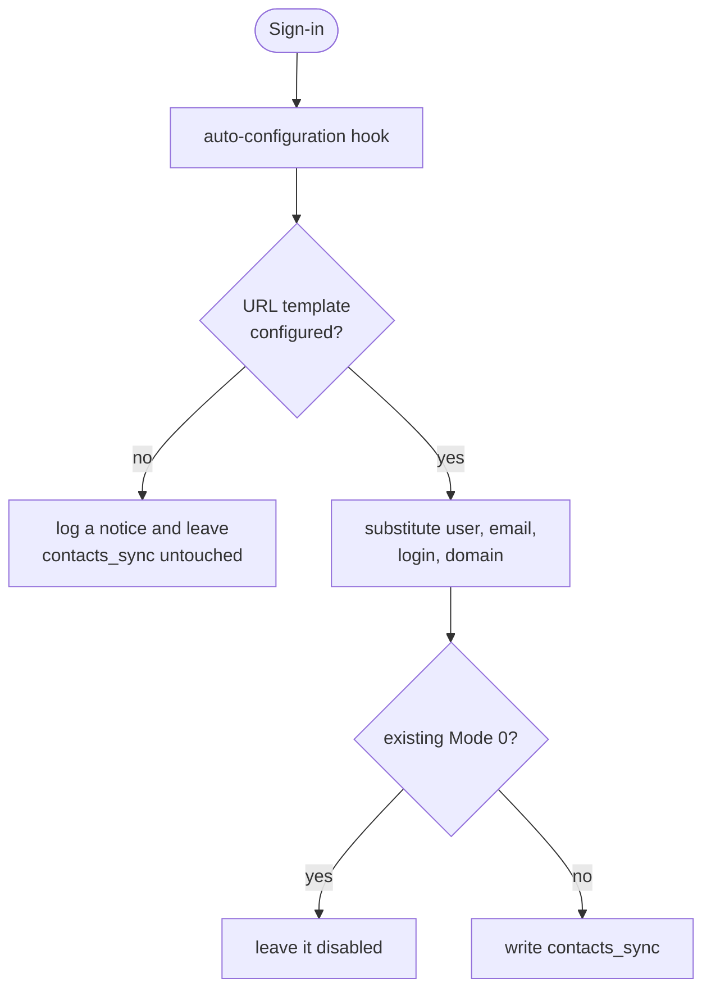

# SnappyMail CardDAV plugin — Cyrus IMAP / standards-compliant fork

[Français](README.md) · **English**

> A fork of the Mailwish / Mailbux **CardDAV Auto** plugin for [SnappyMail](https://snappymail.eu),
> adapted so that it follows the CardDAV standards ([RFC 6352](https://www.rfc-editor.org/rfc/rfc6352))
> closely enough to work against **[Cyrus IMAP](https://www.cyrusimap.org/)**'s CardDAV
> implementation — and, by the same token, against any other standards-compliant CardDAV server.
> On sign-in, it configures the person's address book synchronisation.

| | |
|---|---|
| Version | 1.9.1 (22 October 2026, not deployed) |
| Profile | SnappyMail plugin with no user screen, deployed folder `carddav` |
| Parent software | SnappyMail 2.38.x; companion CalDAV plugin |
| License | **none granted** by the original author — see [AUTHORS](AUTHORS) |
| Reference repository | `git.convergent.tn/fbennasr/SnappyMail-carddav`, mirrored to GitHub |

## Features

- **The server URL is configuration, not code.** Upstream hardcodes one hosting provider's host and
  rewrites the account's `contacts_sync` entry on every login, so contacts never reach any other
  server and a manual correction is silently overwritten at the next sign-in. The URL now comes from
  the plugin's settings page, via a template with `{user}`, `{email}`, `{login}` and `{domain}`
  placeholders. With no template configured the plugin logs a notice and leaves `contacts_sync`
  untouched.
- **Cyrus URL layout.** Cyrus serves `/dav/addressbooks/user/<user>/<collection>`, discoverable
  through `addressbook-home-set`. With `virtdomains: userid` a mailbox in the default domain is
  addressed by its local part.
- **A disabled sync stays disabled.** Upstream unconditionally re-enabled two-way sync on every
  login, overriding an administrator who had turned it off — and a two-way sync against an address
  book that merely *looks* empty deletes local contacts. An existing `Mode: 0` is now preserved.

## Requirements

| Component | Version | Note |
|---|---|---|
| SnappyMail | 2.38.x | sign-in configuration hook |
| CardDAV server | RFC 6352 compliant | tested with Cyrus IMAP |
| Companion CalDAV plugin | — | required by upstream for shared logic |

## Installation

Copy `index.php`, `update-carddav.js` and `langs/` into SnappyMail's `carddav` plugin folder, apply
the SELinux label if relevant, then enable the plugin in the admin panel. Details:
[docs/ADMINISTRATION.en.md](docs/ADMINISTRATION.en.md#installation).

## Configuration

Admin → Plugins → carddav:

| Option | Default | Effect |
|---|---|---|
| CardDAV URL template | empty | e.g. `https://dav.example.com/dav/addressbooks/user/{user}/Default/`; empty, nothing is written |
| DAV default domain | empty | addresses in this domain use the local part only (Cyrus `virtdomains: userid`) |

Reference: [docs/ADMINISTRATION.en.md](docs/ADMINISTRATION.en.md#configuration).

## Usage

Nothing to do on the user's side: on sign-in, contact synchronisation is configured to the person's
address book. A sync an administrator switched off stays off.

## Architecture



Details, and the fixes submitted to SnappyMail upstream (in French):
[docs/ARCHITECTURE.md](docs/ARCHITECTURE.md).

## Security

No third-party host hardcoded any more, a disabled sync is never re-armed, and the plugin holds no
secret: the sync uses the session's credentials. Details (in French):
[docs/SECURITE.md](docs/SECURITE.md). Reporting a vulnerability: [SECURITY.md](SECURITY.md).

## Tests

```sh
php tests/run.php            # 14 checks: URL template, translated settings
```

## Troubleshooting

| Symptom | Likely cause | Fix |
|---|---|---|
| Contacts do not synchronise | empty URL template | set it in the panel |
| Sync only imports | core HTTP header bug, fixed upstream | a SnappyMail version carrying the fix |
| Local contacts disappeared | two-way sync against an empty address book | keep `Mode: 0` until the server is checked |

More cases: [docs/ADMINISTRATION.en.md](docs/ADMINISTRATION.en.md#troubleshooting).

## Documentation

| Document | Audience |
|---|---|
| [Administration](docs/ADMINISTRATION.en.md) · [Français](docs/ADMINISTRATION.md) | administrators |
| [Architecture](docs/ARCHITECTURE.md) (French) | developers |
| [Security](docs/SECURITE.md) (French) | security officer |
| [Architecture decisions](docs/adr/) (French) | developers |
| [Original README, verbatim](docs/README-amont.md) | everyone |
| [Authors and licence](AUTHORS) | everyone |

## Changelog

What changes in each version: [CHANGELOG.md](CHANGELOG.md) (French).

## License

The original author published no licence, and this fork does not add one: the terms are theirs to
set. The copyright in the original code is not ours; anyone wanting to redistribute it should ask
them. See [AUTHORS](AUTHORS).

## Author

Original plugin: Mailwish / Mailbux. Fork: Convergent Cloud Computing — contact@convergent.tn
