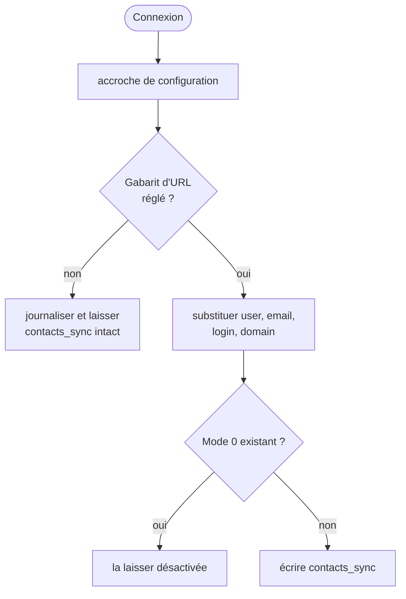

# SnappyMail-carddav — un CardDAV qui parle à n'importe quel serveur conforme

**Français** · [English](README.en.md)

> Fork du greffon **CardDAV Auto** de Mailwish / Mailbux pour [SnappyMail](https://snappymail.eu),
> adapté pour suivre les normes CardDAV ([RFC 6352](https://www.rfc-editor.org/rfc/rfc6352)) d'assez
> près pour fonctionner avec l'implantation CardDAV de **Cyrus IMAP** — et, du même coup, avec tout
> serveur conforme. À la connexion, il configure la synchronisation du carnet d'adresses de la
> personne.

| | |
|---|---|
| Version | 1.9.1 (22 octobre 2026, non déployée) |
| Profil | greffon SnappyMail sans écran utilisateur, dossier déployé `carddav` |
| Logiciel parent | SnappyMail 2.38.x ; greffon CalDAV compagnon |
| Licence | **aucune accordée** par l'auteur d'origine — voir [AUTHORS](AUTHORS) |
| Dépôt de référence | `git.convergent.tn/fbennasr/SnappyMail-carddav`, miroité sur GitHub |

## Fonctionnalités

- **L'URL du serveur est un réglage, plus du code.** L'amont écrivait en dur l'hôte d'un hébergeur
  et réécrivait `contacts_sync` à chaque connexion. L'URL vient désormais d'un gabarit réglable,
  avec `{user}`, `{email}`, `{login}` et `{domain}`. Sans gabarit, le greffon journalise et ne
  touche à rien.
- **Disposition des URL de Cyrus** : `/dav/addressbooks/user/<utilisateur>/<collection>` ; avec
  `virtdomains: userid`, une boîte du domaine par défaut est désignée par sa partie locale.
- **Une synchronisation désactivée reste désactivée.** L'amont la réarmait à chaque connexion ;
  or une synchronisation bidirectionnelle contre un carnet qui *paraît* vide efface les contacts
  locaux. Un `Mode: 0` existant est conservé.

## Prérequis

| Composant | Version | Remarque |
|---|---|---|
| SnappyMail | 2.38.x | accroche de configuration à la connexion |
| Serveur CardDAV | conforme à la RFC 6352 | éprouvé avec Cyrus IMAP |
| Greffon CalDAV compagnon | — | requis par l'amont pour la logique partagée |

## Installation

Copier `index.php`, `update-carddav.js` et `langs/` dans le dossier `carddav` des greffons de
SnappyMail, appliquer l'étiquette SELinux si elle s'applique, puis activer le greffon dans le
panneau d'administration. Détail : [docs/ADMINISTRATION.md](docs/ADMINISTRATION.md#installation).

## Configuration

| Option | Défaut | Effet |
|---|---|---|
| Gabarit d'URL CardDAV | vide | par exemple `https://dav.example.com/dav/addressbooks/user/{user}/Default/` ; vide, rien n'est écrit |
| Domaine DAV par défaut | vide | les adresses de ce domaine n'utilisent que leur partie locale (Cyrus `virtdomains: userid`) |

Référence : [docs/ADMINISTRATION.md](docs/ADMINISTRATION.md#configuration).

## Utilisation

Rien à faire côté utilisateur : à la connexion, la synchronisation des contacts est configurée vers
le carnet de la personne. Une synchronisation qu'un administrateur a éteinte le reste.

## Architecture



Détail, et les correctifs envoyés à l'amont de SnappyMail : [docs/ARCHITECTURE.md](docs/ARCHITECTURE.md).

## Sécurité

Le greffon n'écrit plus d'hôte tiers en dur, ne réarme jamais une synchronisation désactivée et ne
détient aucun secret : la synchronisation utilise les identifiants de la session. Détail :
[docs/SECURITE.md](docs/SECURITE.md). Signaler une vulnérabilité : [SECURITY.md](SECURITY.md).

## Tests

```sh
php tests/run.php            # 14 contrôles : gabarit d'URL, réglages traduits
```

## Dépannage

| Symptôme | Cause probable | Remède |
|---|---|---|
| Les contacts ne se synchronisent pas | gabarit d'URL vide | le régler dans le panneau |
| La synchronisation ne fait qu'importer | défaut d'en-têtes HTTP du cœur, corrigé en amont | version de SnappyMail portant le correctif |
| Des contacts locaux ont disparu | synchronisation bidirectionnelle contre un carnet vide | garder `Mode: 0` tant que le serveur n'est pas vérifié |

Plus de cas : [docs/ADMINISTRATION.md](docs/ADMINISTRATION.md#dépannage).

## Documentation

| Document | Pour qui |
|---|---|
| [Administration](docs/ADMINISTRATION.md) · [English](docs/ADMINISTRATION.en.md) | administrateurs |
| [Architecture](docs/ARCHITECTURE.md) | développeurs |
| [Sécurité](docs/SECURITE.md) | responsable sécurité |
| [Décisions d'architecture](docs/adr/) | développeurs |
| [README d'origine, tel quel](docs/README-amont.md) | tous |
| [Auteurs et licence](AUTHORS) | tous |

## Historique

Les changements de chaque version : [CHANGELOG.md](CHANGELOG.md).

## Licence

Aucune licence n'a été publiée par l'auteur d'origine, et ce fork n'en ajoute pas : les termes lui
appartiennent. Le droit d'auteur du code d'origine n'est pas le nôtre ; quiconque veut le
redistribuer doit le lui demander. Voir [AUTHORS](AUTHORS).

## Auteur

Greffon d'origine : Mailwish / Mailbux. Fork : Convergent Cloud Computing — contact@convergent.tn
