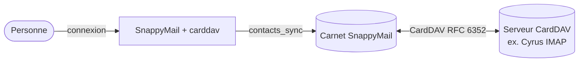
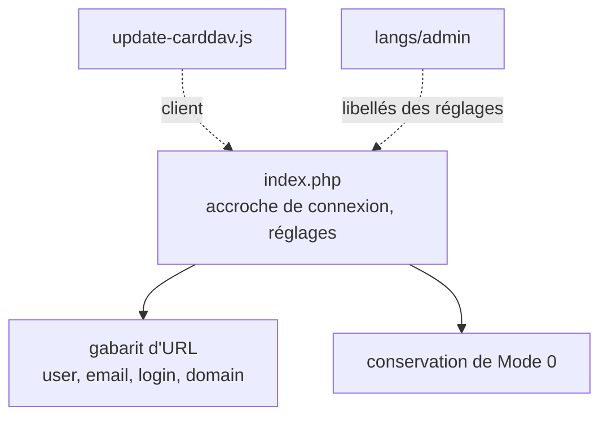
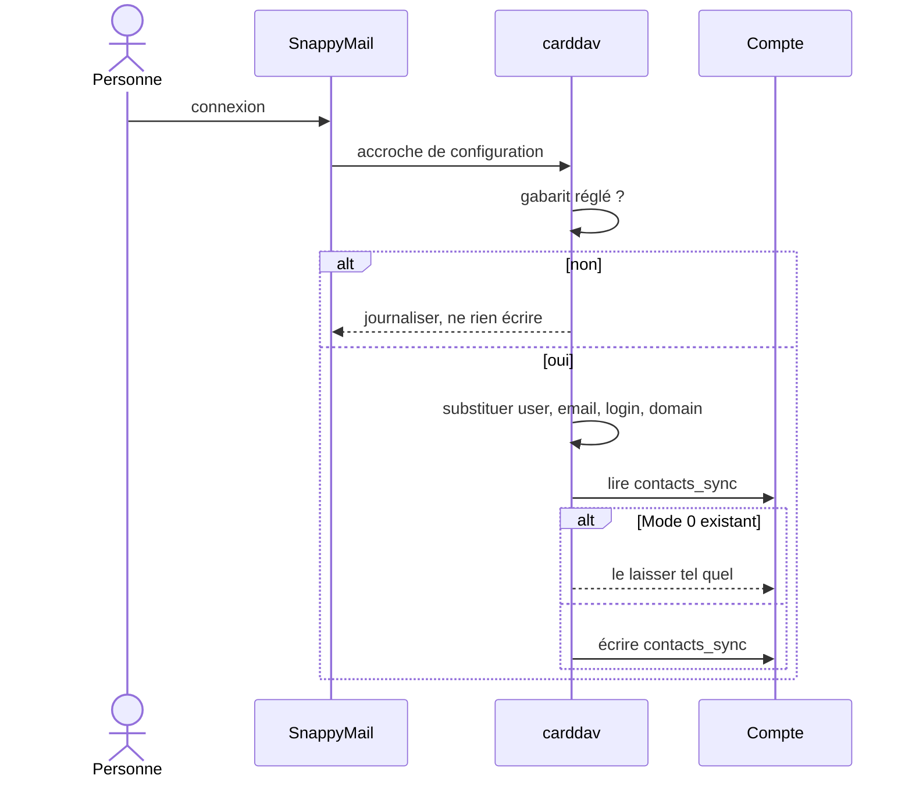

# Architecture — SnappyMail-carddav

## Objectifs et contraintes

- Faire fonctionner le greffon d'origine avec n'importe quel serveur CardDAV conforme, Cyrus IMAP
  en premier.
- Ne jamais écrire une URL qui ne peut pas marcher, ni réarmer une synchronisation éteinte.
- Rester un fork lisible : le README d'origine est conservé tel quel
  ([README-amont.md](README-amont.md)), et les écarts sont dessinés.

## Contexte

## Composants

| Composant | Fichier | Rôle |
|---|---|---|
| Greffon | `index.php` | configuration de `contacts_sync` à la connexion, réglages traduits |
| Client | `update-carddav.js` | côté navigateur, repris de l'amont |
| Catalogues | `langs/admin/{en,fr,ar}.json` | libellés des deux réglages |

Les deux écarts avec l'amont sont les deux branches de la décision : l'amont écrivait un hôte en dur
quand rien n'était réglé, et réarmait une synchronisation éteinte.

## Parcours principal

### Correctifs envoyés à l'amont de SnappyMail

Une synchronisation bidirectionnelle avec Cyrus a aussi exigé deux corrections dans SnappyMail,
proposées à l'amont plutôt que portées ici :

- les pilotes HTTP perdaient les en-têtes associatifs : les envois CardDAV partaient en
  `application/x-www-form-urlencoded` et étaient refusés (`403 supported-address-data`) ;
- `PdoAddressBook::Sync()` tenait une liste vide d'un côté pour autoritaire, si bien qu'une liste
  vide ou en échec effaçait les contacts de l'autre côté (garde `carddav-sync-empty-set-guard`).

## Déploiement

Copié sous `plugins/carddav/` ; empaqueté par l'outil commun de la suite.

## Décisions

| N° | Décision | État |
|---|---|---|
| [0001](adr/0001-consigner-les-decisions.md) | Consigner les décisions d'architecture | acceptée |

Antérieure au registre : ne pas ajouter de licence (voir [AUTHORS](../AUTHORS)).

## Qualité et risques

- Licence non accordée par l'auteur d'origine : la redistribution dépend de lui.
- Dépôt miroité : pousser sur Forgejo seulement.

## Glossaire

| Terme | Définition | English |
|---|---|---|
| carnet d'adresses | collection CardDAV de contacts | address book |
| synchronisation bidirectionnelle | `Mode` qui écrit dans les deux sens | two-way sync |
| fork | copie modifiée d'un projet tiers | fork |
