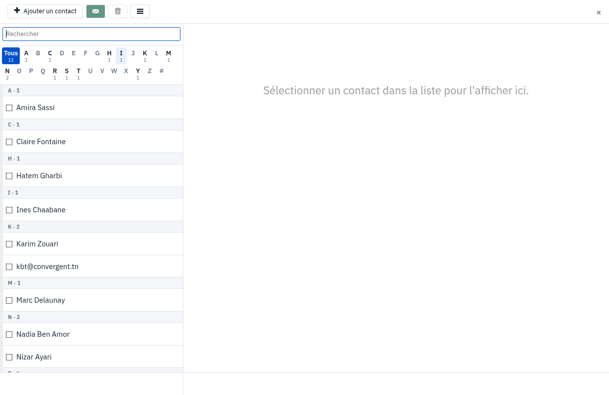
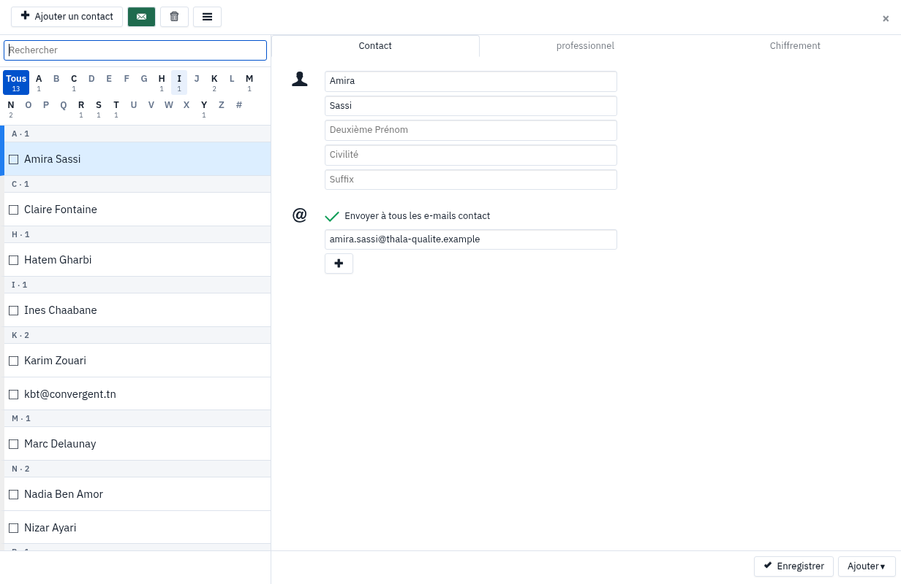

# User guide — the address book

The address book keeps your contacts: names, addresses, phone numbers, company. It opens from the
**Contacts** tile of the app bar, and it is the same on all your devices: a contact added in the webmail
shows up on your phone if the phone is linked to your account.

## Open the address book

1. In the app bar, click **Contacts**.

**Result:** the list of your contacts appears, sorted by letter. The number under each letter says how many
contacts start with it; **All** shows them all.

## Find a contact

**What it is for:** find someone without scrolling the whole list.

1. Type part of the name or address in the search field at the top of the list.
2. Or click a letter to keep only the contacts that start with it.

**Result:** the list narrows to the contacts found. **Clear search** brings back the whole list.

## View and edit a contact

1. Click a contact in the list.
2. Their card opens on the right, with the **Contact**, **Business** and **Crypto** tabs.
3. Change what you need: first name, last name, email address… **Add** offers more fields: **Phone**,
   **Address**, **Birthday**, **Notes**, **URL**, **Nickname**, **Tags**.
4. Click **Save**.

**Result:** the card is updated, here and on your other devices.

## Add a contact

1. Click **Add Contact**, at the top left.
2. Fill in at least the name and the email address.
3. Click **Create**.

**Result:** the contact appears in the list, under its letter.

To add the sender of a message you are reading, there is a quicker way: see the guide "Add the sender to
your contacts".

## Write to one or more contacts

1. Tick the contacts you want in the list.
2. Click the green envelope button.

**Result:** a new message opens, addressed to the ticked contacts.

## Delete a contact

1. Tick the contact or contacts.
2. Click the bin.

**Result:** the contacts are removed from the address book, on all your devices.

## Import or export your contacts

**What it is for:** bring in the contacts of another service, or keep a copy.

1. Click the **☰** menu at the top of the list.
2. Choose **Import (csv, vcf, vCard)** and pick the file, or **Export (vcf, vCard)** or **Export (csv)**.

**Result:** on import, the contacts of the file join your address book; on export, the browser downloads
the file.

## Frequently asked questions

**Do my contacts show up on my phone?**
Yes, if your phone is linked to your account (see the guide "Set up your phone"). The address book is the
same everywhere.

**A contact cannot be edited.**
It may be marked **Read only**: such a contact cannot be changed from here. Ask the person who manages it.
